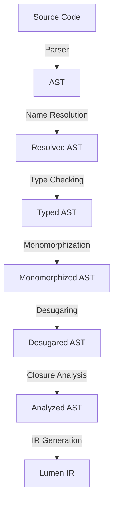

# Lumen Compilation Pipeline Specification

This document outlines the architecture and implementation plan for the Lumen compilation pipeline. The goal is to transform the Abstract Syntax Tree (AST) into an Intermediate Representation (IR) through a series of atomic, testable, and well-defined steps.

## Overview

The compilation process is designed as a linear pipeline. Each stage transforms the data or enriches it with information.



## Package Structure

To maintain modularity and testability, the implementation will be distributed across the following packages in `internal/`:

*   `internal/ast`: Defines the AST nodes (Existing).
*   `internal/resolve`: Handles Name Resolution.
*   `internal/types`: Handles Type Checking (Existing).
*   `internal/monomorph`: Handles Generics Resolution.
*   `internal/desugar`: Handles AST transformations (loops, match, etc.).
*   `internal/analysis`: Handles Closure Analysis and other semantic checks.
*   `internal/ir`: Defines the IR structure (Existing).
*   `internal/irgen`: Handles conversion from AST to IR.
*   `internal/compiler`: Orchestrates the entire pipeline.
*   `internal/errors`: Centralized error handling for meaningful diagnostics.

---

## Pipeline Steps

### 1. Name Resolution (`internal/resolve`)

**Goal**: Link every identifier usage to its declaration. Ensure no undefined variables or shadowing conflicts (unless allowed).

*   **Input**: `*ast.Program`
*   **Output**: `*resolve.Table` (Mapping of `ast.Node` to `Scope/Symbol`) or enriched AST.
*   **Key Responsibilities**:
    *   Build symbol tables for each scope (global, function, block).
    *   Resolve imports and qualified names.
    *   Detect "undefined variable" and "redeclaration" errors.
*   **Testing Strategy**:
    *   Unit tests with snippets of code checking if `x` resolves to the correct declaration of `x`.
    *   Negative tests for undefined variables.

### 2. Type Checking (`internal/types`)

**Goal**: Verify that operations are performed on compatible types and assign types to every expression.

*   **Input**: `*ast.Program`, `*resolve.Table`
*   **Output**: `*types.Info` (Mapping of `ast.Expr` to `types.Type`).
*   **Key Responsibilities**:
    *   Type inference for variables (if supported).
    *   Check function call arguments against signatures.
    *   Check binary/unary operator compatibility.
    *   Validate trait/interface implementations.
*   **Testing Strategy**:
    *   Test cases for type mismatches (e.g., `1 + "string"`).
    *   Test cases for valid complex type interactions.

### 3. Generics Resolution / Monomorphization (`internal/monomorph`)

**Goal**: Instantiate generic functions and structs for concrete types used in the program.

*   **Input**: `*ast.Program`, `*types.Info`
*   **Output**: `*ast.Program` (Modified AST with concrete instances).
*   **Key Responsibilities**:
    *   Identify all calls to generic functions.
    *   Generate concrete versions of functions/structs for each unique type argument set.
    *   Replace generic calls with calls to the concrete versions.
    *   *Note*: This step might expand the AST significantly.
*   **Testing Strategy**:
    *   Verify that a generic function called with `Int` and `Float` generates two distinct functions.

### 4. AST Desugaring (`internal/desugar`)

**Goal**: Simplify the AST by transforming complex constructs into simpler ones.

*   **Input**: `*ast.Program` (Monomorphized)
*   **Output**: `*ast.Program` (Simplified).
*   **Key Responsibilities**:
    *   Convert `for` loops into `while` loops or `loop` + `break`.
    *   Convert `match` expressions into `if-else` chains or jump tables.
    *   Handle any syntactic sugar.
*   **Testing Strategy**:
    *   Input AST with a `for` loop -> Output AST with equivalent `while` loop structure.

### 5. Closure Analysis (`internal/analysis`)

**Goal**: Identify variables captured by closures and determine how they should be stored (stack vs heap/environment).

*   **Input**: `*ast.Program`
*   **Output**: `*analysis.CaptureInfo` (Map of closures to captured variables).
*   **Key Responsibilities**:
    *   Detect free variables in function literals.
    *   Determine if variables escape their scope.
    *   Mark variables that need to be moved to a heap-allocated environment.
*   **Testing Strategy**:
    *   Test that a variable used inside a returned lambda is marked as captured.

### 6. IR Generation (`internal/irgen`)

**Goal**: Translate the fully analyzed and simplified AST into Linear IR (Intermediate Representation).

*   **Input**: `*ast.Program`, `*types.Info`, `*analysis.CaptureInfo`
*   **Output**: `*ir.Program` (or `*ir.Module`).
*   **Key Responsibilities**:
    *   Generate `ir.Function` for each AST function.
    *   Generate `ir.BasicBlock`s for control flow.
    *   Translate expressions into SSA-like or register-based instructions (`ir.Instruction`).
    *   Handle short-circuiting logic (`&&`, `||`).
*   **Testing Strategy**:
    *   "Golden file" tests: Input source code -> Expected text representation of IR.

---

## Error Handling Strategy

We will define a standard `Diagnostic` structure in `internal/errors` (or `internal/diagnostics`).

```go
type Diagnostic struct {
    Severity Severity // Error, Warning, Info
    Message  string
    File     string
    Line     int
    Col      int
    Context  string // The line of code causing the error
    Suggestion string // Optional fix suggestion
}
```

*   **Accumulation**: The compiler should attempt to continue after errors (where possible) to report multiple issues.
*   **Rich Reporting**: Errors should point to the exact span in the source code.

## Implementation Roadmap

1.  **Infrastructure Setup**: Create the package structure and the `Diagnostic` system.
2.  **Step-by-Step Implementation**:
    *   Implement `resolve` for basic variables.
    *   Implement `types` for basic primitives.
    *   Implement `irgen` for basic arithmetic.
    *   *Verify end-to-end flow for simple programs.*
3.  **Feature Expansion**:
    *   Add control flow (if/else) to all steps.
    *   Add functions to all steps.
    *   Add structs/types to all steps.
4.  **Advanced Features**:
    *   Implement Generics and Monomorphization.
    *   Implement Closures.
